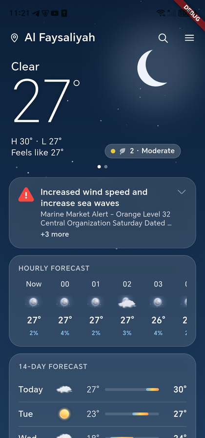
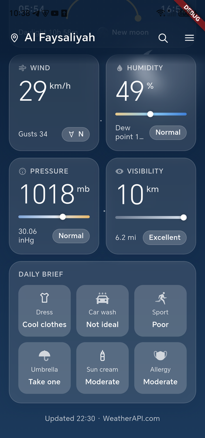
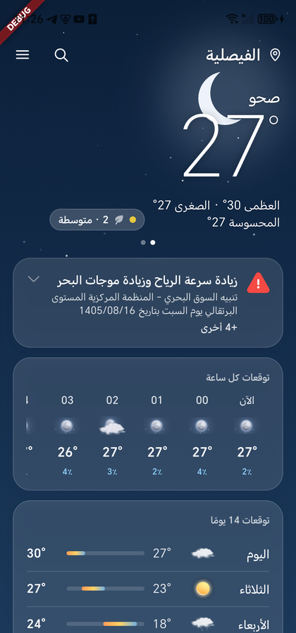
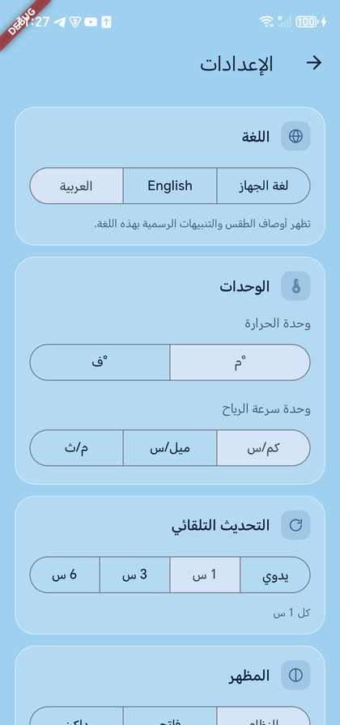

# HoWeather

A clean, bilingual (English / العربية) weather app built with Flutter.

<p>
  
  
  
  
</p>

## Features

- **Current conditions** over a sky background that follows the weather and time of day.
- **Hourly and 14-day forecasts** with temperature range bars.
- **Detail cards**: air quality, UV index (with today's peak), wind with a direction arrow, humidity and dew point, pressure, and visibility, each with a colour scale and a plain-language state.
- **Sunrise & sunset** with the sun's progress, day length and the moon phase.
- **Official weather alerts**, most severe first. Alerts arrive in the issuing agency's language; they are translated on the device into the app language.
- **Daily brief**: what to wear, car washing, sport, umbrella, sun cream and allergy outlook.
- **Multiple cities** with search, current location, drag-to-reorder and swipe between cities.
- **English and Arabic** with full right-to-left layout. The language can follow the device or be chosen in Settings; place names are translated too.
- Units (°C/°F, km/h, mph, m/s), auto-update interval and light/dark theme.
- Offline cache: the last forecast stays available without a connection.

## Getting started

### Requirements

- Flutter with Dart SDK `^3.13`
- A free API key from [WeatherAPI.com](https://www.weatherapi.com/)

### Run

```bash
git clone https://github.com/amolood/HoWeather.git
cd HoWeather
flutter pub get

# Add your API key (env.json is git-ignored)
cp env.example.json env.json
# then edit env.json: {"WEATHERAPI_KEY":"<your key>"}

flutter run --dart-define-from-file=env.json
```

The key is read at build time with `String.fromEnvironment('WEATHERAPI_KEY')`; it is never stored in the source.

### Tests

```bash
flutter analyze
flutter test
```

## Translation

Alerts and place names are translated with [Google ML Kit](https://developers.google.com/ml-kit/language/translation) on the device. Each language model (about 30 MB) downloads once on first use and then works offline. Until it is available, place names show in English and alerts show their original text, labelled as such.

## Project structure

```
lib/
  config.dart          API configuration (key from --dart-define)
  data/                API client, mapper, cache, preferences, location, translation
  domain/              Models, condition mapping, units, life indices, alerts
  state/               Riverpod providers
  ui/
    home/              Home screen and per-city page
    cards/             Hero, hourly, daily, metric, sun, alerts and daily brief cards
    cities/            City list and search
    settings/          Settings screen
    sky/               Animated sky background and palettes
    icons/             Line glyphs and image icons
  l10n/                English and Arabic strings (ARB)
test/                  Unit and widget tests
```

## Credits

- Weather data by [WeatherAPI.com](https://www.weatherapi.com/).
- Some weather illustrations and icons in `assets/icons/` are third-party artwork and are not covered by this project's license.

## License

The source code is released under the [MIT License](LICENSE).

---

## بالعربية

**هو ويذر** تطبيق طقس بالعربية والإنجليزية مبني بـ Flutter: الحالة الحالية، توقعات كل ساعة ولمدة 14 يوماً، جودة الهواء والأشعة فوق البنفسجية والرياح والرطوبة والضغط ومدى الرؤية، الشروق والغروب وطور القمر، والتنبيهات الرسمية مترجمة تلقائياً إلى لغة التطبيق.

للتشغيل: انسخ `env.example.json` إلى `env.json` وضع فيه مفتاحك من WeatherAPI.com، ثم شغّل:

```bash
flutter run --dart-define-from-file=env.json
```
